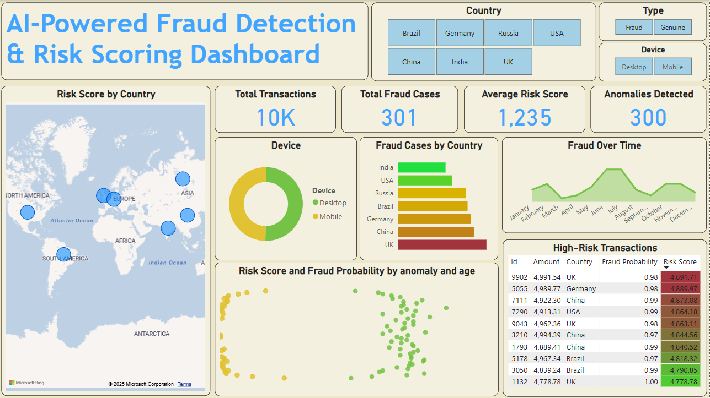

# 🛡️ AI-Powered Fraud Detection & Risk Scoring System

Hệ thống phát hiện gian lận giao dịch và chấm điểm rủi ro, gồm pipeline huấn luyện mô hình, backend **FastAPI**, frontend **React** và dashboard phân tích. Người dùng tải lên file giao dịch (CSV/XLSX), hệ thống chạy job chấm điểm nền rồi trả về dashboard tổng quan, danh sách giao dịch, giải thích "Why?" và file kết quả xuất ra.

- **Mô hình:** Random Forest (phân loại) + Isolation Forest (bất thường) + hiệu chuẩn xác suất Platt.
- **Chấm điểm:** xác suất gian lận, anomaly, risk score 0–100, risk level (`low` → `critical`), quyết định (`allow` / `manual_review` / `block`).
- **Lưu trữ:** SQLite cho analysis job và giao dịch đã chấm điểm; artifact mô hình ở `backend/artifacts/`.

---

## 📋 Tính năng chính

| Nhóm | Chức năng |
|---|---|
| Upload & phân tích | Tải `.csv`/`.xlsx` (≤ 20 MB, ≤ 100.000 dòng), tạo analysis job chạy nền, theo dõi tiến độ `queued → processing → completed/failed` |
| Lịch sử | Danh sách phiên phân tích, trạng thái, số dòng đã xử lý, xóa phiên kèm toàn bộ giao dịch con |
| Dashboard | KPI tổng quan, phân bố risk/decision, xu hướng theo ngày, top thiết bị/quốc gia |
| Giao dịch | Lọc theo `risk_level`/`decision`, tìm kiếm, sắp xếp, phân trang |
| Chi tiết "Why?" | Risk score, level, decision, danh sách `reasons` và đầy đủ field gốc của dòng upload |
| Xuất kết quả | Tải CSV hoặc XLSX với toàn bộ cột chấm điểm |
| API legacy | Chấm điểm 1 giao dịch (`/predict`) và batch CSV (`/predict/batch`) |
| Model meta | Ngưỡng quyết định và metrics hiện tại của artifact (`/api/v1/model/meta`) |

---

## 🏗️ Kiến trúc

```
Người dùng
   │  upload CSV/XLSX
   ▼
React + Vite (5173) ──/api (proxy)──► FastAPI (8000)
                                        │
                          ┌─────────────┼──────────────┐
                          ▼             ▼              ▼
                   BackgroundTask   SQLAlchemy      FraudModel
                   chấm điểm nền    SQLite          RandomForest +
                   theo chunk       data/app.db     IsolationForest
                                        │
                                        ▼
                                backend/artifacts/
                                (joblib + JSON)
```

- Job phân tích chạy bằng `BackgroundTasks` của FastAPI, chia dữ liệu thành từng chunk 5.000 dòng và cập nhật `processed_rows` sau mỗi chunk.
- Khi server khởi động, các job `queued`/`processing` còn sót từ lần chạy trước được đánh dấu `failed` (không tự resume).
- Frontend dev proxy `/api` → `http://localhost:8000`, nên không cần cấu hình CORS khi chạy local.

---

## 📁 Cấu trúc dự án

```
├── backend/
│   ├── app.py                 # FastAPI entry point + legacy endpoints
│   ├── api_v1.py              # Router /api/v1: upload, job, dashboard, transactions, export
│   ├── storage.py             # SQLAlchemy models + SQLite (analyses, transactions)
│   ├── data_pipeline.py       # Chuẩn hóa dữ liệu, Kaggle adapter, feature engineering, FeatureState
│   ├── model_service.py       # Random Forest + Isolation Forest + hiệu chuẩn xác suất
│   ├── risk_scoring.py        # Risk score / level / decision
│   ├── schemas.py             # Pydantic request/response
│   └── artifacts/             # Model đã train + thresholds + metrics (JSON)
├── frontend/
│   ├── src/
│   │   ├── api/               # Client gọi backend
│   │   ├── components/        # Badge, StatCard, ChartCard...
│   │   ├── hooks/             # React Query hooks
│   │   ├── pages/             # Upload, History, Dashboard, Transactions, TransactionDetail
│   │   ├── types/             # Kiểu dữ liệu dùng chung
│   │   └── App.tsx            # Routes + layout
│   ├── vite.config.ts         # Dev server 5173 + proxy /api
│   └── vitest.config.ts
├── scripts/                   # CLI: generate data, train, evaluate, report, benchmark
├── tests/                     # Pytest cho backend
├── data/
│   ├── sample_transactions.csv  # File mẫu để thử upload
│   ├── training_data.csv        # Dataset demo
│   ├── app.db                   # SQLite (sinh tự động, git-ignored)
│   └── kaggle/                  # fraudTrain.csv, fraudTest.csv (git-ignored)
├── docs/chapter3/             # Tài liệu phân tích & thiết kế, biểu đồ, screenshot
├── plan/API_CONTRACT.md       # Hợp đồng API BE ↔ FE
├── fraud_dashboard_dataset.csv
├── Dashboard.pbix             # Dashboard Power BI
├── run_all.bat                # Pipeline một chạm (Windows)
├── run_tuned.bat              # Pipeline có chế độ (Windows)
├── requirements.txt
└── AI_Driven_Fraud_Detection_&_Risk_Scoring_System.ipynb  # Notebook phân tích ban đầu
```

---

## 🛠️ Công nghệ sử dụng

**Backend**
- Python 3.10+, FastAPI + Uvicorn, Pydantic
- SQLAlchemy 2 + SQLite
- scikit-learn: `RandomForestClassifier`, `IsolationForest`, `LogisticRegression` (hiệu chuẩn xác suất)
- pandas, NumPy, Joblib

**Frontend**
- React 18 + TypeScript, Vite 5
- Tailwind CSS 4, TanStack Query, React Router 6
- Recharts

**Kiểm thử & công cụ**
- Pytest (backend), Vitest + Testing Library (frontend)
- Power BI (dashboard EDA), Jupyter Notebook

---

## 🧠 Pipeline huấn luyện

### Dữ liệu

- Nguồn chính: Kaggle **kartik2112/fraud-detection** — đặt `fraudTrain.csv` và `fraudTest.csv` vào `data/kaggle/extracted/`.
- Không có Kaggle: dùng dataset demo `data/training_data.csv` (hoặc sinh lại bằng `scripts/generate_training_data.py`).
- Chia theo thời gian **60/20/20** cho fit / calibration / threshold; tập `fraudTest` dùng làm kiểm thử cuối.

### Đặc trưng (34 chiều)

- Velocity/history: số giao dịch và tổng tiền theo 5 phút, 1 giờ, 24 giờ, 7 ngày.
- Hành vi: `amount_vs_card_avg`, `amount_zscore_card`, `time_since_last_transaction`.
- Địa lý: khoảng cách tới nhà, tới giao dịch trước, tới merchant, `impossible_travel`.
- Merchant/category: lịch sử tần suất và tỷ lệ gian lận, `is_new_merchant`, `is_new_city`, `is_new_state`.
- Thời gian: giờ, thứ, cuối tuần, ban đêm, `hour_sin`/`hour_cos`.
- `merchant_category` được one-hot; `merchant_id` không được mã hóa one-hot (cardinality cao), nhưng các feature lịch sử/tần suất của merchant vẫn được giữ.

### Huấn luyện & ngưỡng

- Random Forest 250 cây, `class_weight="balanced_subsample"`, `min_samples_leaf=2`.
- Isolation Forest (tối đa 200k dòng đại diện) cho tín hiệu bất thường.
- Xác suất được hiệu chuẩn bằng Platt sigmoid trên cửa sổ calibration theo thời gian.
- Bốn profile ngưỡng:
  - `high_recall`: recall ≥ 0.95
  - `balanced`: precision ≥ 0.30
  - `strict`: precision ≥ 0.45 (profile duy nhất có thể trả `block`)
  - `cost_optimal` (mặc định): tối thiểu chi phí FN=100, FP=2, TP=1

### Metrics hiện tại (artifact `evaluation_metrics.json`)

Đánh giá trên 500.000 dòng test cuối, profile `cost_optimal`:

| Chỉ số | Giá trị |
|---|---|
| Precision | 0.5055 |
| Recall | 0.9576 |
| F1 | 0.6617 |
| ROC-AUC | 0.9927 |
| PR-AUC | 0.9280 |
| Fraud rate | 0.42% |

> Số liệu thay đổi theo lần train gần nhất; xem trực tiếp trong `backend/artifacts/evaluation_metrics.json` hoặc qua `GET /api/v1/model/meta`.

---

## ⚖️ Cách tính risk score

```
risk_score = 100 × (0.75 × fraud_probability + 0.25 × max(anomaly_score, anomaly))
```

| Risk score | Risk level |
|---|---|
| ≥ 80 | `critical` |
| ≥ 60 | `high` |
| ≥ 30 | `medium` |
| < 30 | `low` |

- `decision`:
  - `block`: chỉ khi `threshold_profile=strict` và `probability ≥ threshold`
  - `manual_review`: `probability ≥ threshold`
  - `allow`: còn lại
- `reasons`:
  - `high_model_probability`: xác suất vượt ngưỡng của profile
  - `anomalous_transaction_pattern`: Isolation Forest gắn cờ bất thường
  - `high_transaction_amount`: số tiền ≥ 3.000
- API v1 trả `risk_level` chữ thường; endpoint legacy giữ chữ hoa (`Low`, `Medium`, `High`, `Critical`).

---

## 🔌 API

Base URL: `http://localhost:8000` — Swagger UI tại `/docs`. Hợp đồng chi tiết: [`plan/API_CONTRACT.md`](plan/API_CONTRACT.md).

### v1 — `/api/v1` (frontend sử dụng)

| Method | Endpoint | Mô tả |
|---|---|---|
| POST | `/api/v1/analyses` | Upload `file` (`.csv`/`.xlsx`) + `threshold_profile`, trả `202` kèm analysis `queued` |
| GET | `/api/v1/analyses` | Danh sách phiên phân tích (`page`, `page_size`) |
| GET | `/api/v1/analyses/{id}` | Trạng thái job; khi `completed` có `summary` cho dashboard |
| GET | `/api/v1/analyses/{id}/transactions` | Danh sách giao dịch: lọc `risk_level`, `decision`, `q`, sort, phân trang |
| GET | `/api/v1/analyses/{id}/transactions/{transaction_id}` | Chi tiết + `reasons` + `raw` ("Why?") |
| GET | `/api/v1/analyses/{id}/export?format=csv\|xlsx` | Xuất kết quả (chỉ khi `completed`) |
| DELETE | `/api/v1/analyses/{id}` | Xóa phiên phân tích và giao dịch con (`204`) |
| GET | `/api/v1/model/meta` | Model version, thresholds, metrics |

Lỗi v1 dùng envelope thống nhất:

```json
{ "error": { "code": "ANALYSIS_NOT_FOUND", "message": "Analysis 99 does not exist" } }
```

Các mã thường gặp: `UNSUPPORTED_FORMAT` (400), `FILE_TOO_LARGE` / `ROW_LIMIT_EXCEEDED` (413), `INVALID_FILE` / `VALIDATION_ERROR` (422), `ANALYSIS_NOT_FOUND` / `TRANSACTION_NOT_FOUND` (404), `ANALYSIS_NOT_COMPLETED` (409), `MODEL_NOT_LOADED` (503).

### Legacy (giữ tương thích, FE không dùng)

| Method | Endpoint | Mô tả |
|---|---|---|
| GET | `/health` | `{status, model_loaded}` |
| POST | `/predict?threshold_profile=...` | Chấm điểm một giao dịch |
| POST | `/predict/batch?threshold_profile=...` | Upload CSV, trả `{count, predictions[]}` |

### Ví dụ

Tạo phiên phân tích từ file mẫu:

```bash
curl -X POST http://localhost:8000/api/v1/analyses \
  -F "file=@data/sample_transactions.csv" \
  -F "threshold_profile=balanced"
```

Chấm điểm một giao dịch:

```bash
curl -X POST "http://localhost:8000/predict?threshold_profile=cost_optimal" \
  -H "Content-Type: application/json" \
  -d '{
    "user_id": 100,
    "age": 34,
    "amount": 1200.50,
    "payment_method": "credit",
    "device": "mobile",
    "country": "US",
    "transaction_time": "2024-03-15T10:30:00"
  }'
```

Tải kết quả:

```bash
curl -L -o results.xlsx \
  "http://localhost:8000/api/v1/analyses/1/export?format=xlsx"
```

### Định dạng file upload

- **Bắt buộc:** `amount` (> 0), `transaction_time`.
- **Tùy chọn:** `transaction_id` (nếu có phải unique trong file), `user_id`, `age`, `payment_method`, `device`, `country`, và các cột địa lý/merchant (`merchant_category`, `city`, `state`, `customer_lat/long`, `merchant_lat/long`...).
- Cột nhãn `is_fraud` / `label` (nếu có) chỉ dùng để tính `labeled_fraud_rate`, không đưa vào mô hình.
- File Kaggle (`trans_num`, `cc_num`, `trans_date_trans_time`, `amt`, ...) được adapter tự động ánh xạ.

---

## 🖥️ Giao diện web

| Route | Trang |
|---|---|
| `/` | Upload file và chọn threshold profile |
| `/analyses` | Lịch sử phân tích, trạng thái job, xóa phiên |
| `/analyses/:id` | Dashboard tổng quan của phiên |
| `/analyses/:id/transactions` | Bảng giao dịch có lọc/sắp xếp/tìm kiếm |
| `/analyses/:id/transactions/:txnId` | Chi tiết giao dịch + giải thích "Why?" |

---

## 🚀 Cài đặt & chạy

### Yêu cầu

- Python 3.10+
- Node.js 18+
- Git

### 1. Clone

```bash
git clone https://github.com/chaoe723/AI-Powered-Fraud-Detection-Risk-Scoring-System.git
cd AI-Powered-Fraud-Detection-Risk-Scoring-System
```

### 2. Cài dependencies backend

```bash
python -m pip install -r requirements.txt
```

### 3. (Tùy chọn) Train lại mô hình

Model đã có sẵn trong `backend/artifacts/`, chỉ cần train lại khi muốn cập nhật:

```bash
# Dùng Kaggle (cần data/kaggle/extracted/fraudTrain.csv + fraudTest.csv)
python scripts\train_model.py

# Giới hạn số dòng để chạy nhanh
python scripts\train_model.py --max-rows 50000

# Dùng dataset demo (không cần Kaggle)
python scripts\train_model.py --synthetic
```

### 4. Chạy backend

```bash
python -m uvicorn backend.app:app --reload
```

- API: <http://localhost:8000>
- Swagger: <http://localhost:8000/docs>
- Lần chạy đầu tự tạo SQLite tại `data/app.db`.

### 5. Chạy frontend

```bash
cd frontend
npm install
npm run dev
```

Mở <http://localhost:5173>, tải lên `data/sample_transactions.csv`, chờ job hoàn tất rồi xem dashboard, lọc giao dịch, mở "Why?" và xuất kết quả.

### Biến môi trường

| Biến | Mặc định | Ý nghĩa |
|---|---|---|
| `FRAUD_DB_PATH` | `data/app.db` | Đường dẫn SQLite |
| `FRAUD_CORS_ORIGINS` | `http://localhost:5173` | Danh sách origin CORS, phân tách bằng dấu phẩy |
| `FRAUD_RF_THREADS` | `2` | Số thread Random Forest khi train |

---

## 🧪 Kiểm thử

```bash
# Backend
python -m pytest -q

# Frontend
cd frontend
npm test          # Vitest
npm run typecheck # tsc --noEmit
npm run lint      # ESLint
npm run build     # typecheck + production build
```

---

## 📜 Script CLI

| Script | Công dụng |
|---|---|
| `scripts/generate_training_data.py` | Sinh dataset demo (`data/training_data.csv`) |
| `scripts/train_model.py` | Train model, ghi artifact (`--synthetic`, `--max-rows`, `--artifact-dir`) |
| `scripts/evaluate_model.py` | Đánh giá trên tập test, ghi `evaluation_metrics.json` |
| `scripts/show_report.py` | In báo cáo metrics/thresholds |
| `scripts/benchmark_models.py` | So sánh các mô hình ứng viên |

### Pipeline một chạm (Windows)

```bat
:: Full: install → train → evaluate → test → benchmark → API
run_all.bat

:: Giới hạn số dòng
run_all.bat 50000

:: Đánh giá lại model có sẵn (không train lại)
run_all.bat resume

:: Pipeline có chế độ
run_tuned.bat setup                 :: cài dependencies
run_tuned.bat quick                 :: validate 5k dòng, không benchmark/API
run_tuned.bat full                  :: train + evaluate + test + report + API
run_tuned.bat 50000                 :: train/evaluate với 50k dòng
run_tuned.bat resume [rows]         :: đánh giá lại model có sẵn
run_tuned.bat train [rows]          :: chỉ train
run_tuned.bat evaluate [rows]       :: chỉ evaluate + report
run_tuned.bat benchmark [rows]      :: so sánh model (mặc định 500k dòng)
run_tuned.bat serve                 :: chỉ chạy/tái sử dụng API
```

---

## 📊 Dashboard Power BI & phân tích dữ liệu



Dashboard Power BI (`Dashboard.pbix`, dữ liệu `fraud_dashboard_dataset.csv`) phục vụ phân tích khám phá: xu hướng gian lận theo thời gian, phân bố theo thiết bị/quốc gia, quan hệ giữa xác suất gian lận và risk score.


Notebook `AI_Driven_Fraud_Detection_&_Risk_Scoring_System.ipynb` chứa phần phân tích dữ liệu và thử nghiệm ban đầu.

---

## 📚 Tài liệu

| File | Nội dung |
|---|---|
| [`plan/API_CONTRACT.md`](plan/API_CONTRACT.md) | Hợp đồng API BE ↔ FE |
| [`docs/chapter3/03_phan_tich_thiet_ke.md`](docs/chapter3/03_phan_tich_thiet_ke.md) | Chương 3: phân tích & thiết kế hệ thống |
| [`MODEL_THEORY_AND_DATA_CLEANING_DRAFT.md`](MODEL_THEORY_AND_DATA_CLEANING_DRAFT.md) | Lý thuyết mô hình và làm sạch dữ liệu |
| [`DATA_MODEL_SCHEMA.md`](DATA_MODEL_SCHEMA.md) | Mô tả schema dữ liệu |
| [`CHANGELOG.md`](CHANGELOG.md) | Lịch sử thay đổi |
| [`TEAM_COORDINATION_PLAN_CORE_BE_FE.md`](TEAM_COORDINATION_PLAN_CORE_BE_FE.md) | Kế hoạch phối hợp BE/FE |

---

## ⚠️ Giới hạn & lưu ý

- `BackgroundTasks` chạy trong process API: phù hợp demo, nhưng chỉ nên chạy **một worker**; production nên tách queue (Celery/RQ) và dùng Postgres.
- SQLite đủ cho demo; toàn bộ truy cập DB nằm trong `backend/storage.py` để dễ thay thế.
- `backend/artifacts/fraud_model.joblib` hiện ~61 MB, vượt khuyến nghị 50 MB của GitHub; nên dùng **Git LFS** nếu tiếp tục phát triển.
- Đây là hệ thống phục vụ mục đích học thuật/demo, không dùng trực tiếp cho quyết định tín dụng thực tế.

---

## 📬 Repo

<https://github.com/chaoe723/AI-Powered-Fraud-Detection-Risk-Scoring-System>
