# CHƯƠNG 3. PHÂN TÍCH VÀ THIẾT KẾ HỆ THỐNG

---

## 3.1. Phân tích hệ thống

Hệ thống được phân tích theo bốn góc độ: (1) mô hình hóa yêu cầu chức năng bằng biểu đồ ca sử dụng, (2) mô hình hóa nghiệp vụ bằng biểu đồ hoạt động, (3) phân tích cấu trúc bằng biểu đồ lớp và (4) phân tích hành vi bằng biểu đồ tuần tự. Các tác nhân của hệ thống gồm:

- **Người phân tích (Analyst):** tác nhân chính — tải file giao dịch, theo dõi phiên phân tích, tra cứu kết quả, xuất báo cáo.
- **Quản trị viên (Admin):** quản lý phiên phân tích (xóa dữ liệu lỗi), theo dõi trạng thái model và ngưỡng quyết định.
- **Hệ thống AI (ML Engine):** tác nhân nền — thực thi job chấm điểm bằng Random Forest + Isolation Forest.

### 3.1.1. Mô hình hóa yêu cầu chức năng với biểu đồ ca sử dụng

#### a. Biểu đồ chức năng

Hệ thống có 9 chức năng cho Người phân tích và 3 chức năng cho Quản trị viên. Biểu đồ chức năng dưới đây gom nhóm thành các cụm chức năng chính theo hai tác nhân.

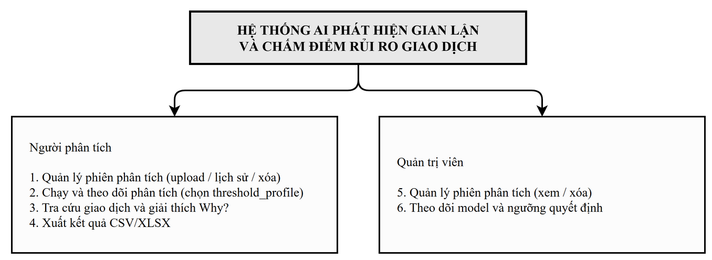

*Hình 3.1. Biểu đồ chức năng* — [draw.io](diagrams/Hình 3.1. Biểu đồ chức năng.drawio)

#### b. Biểu đồ Use Case tổng quát

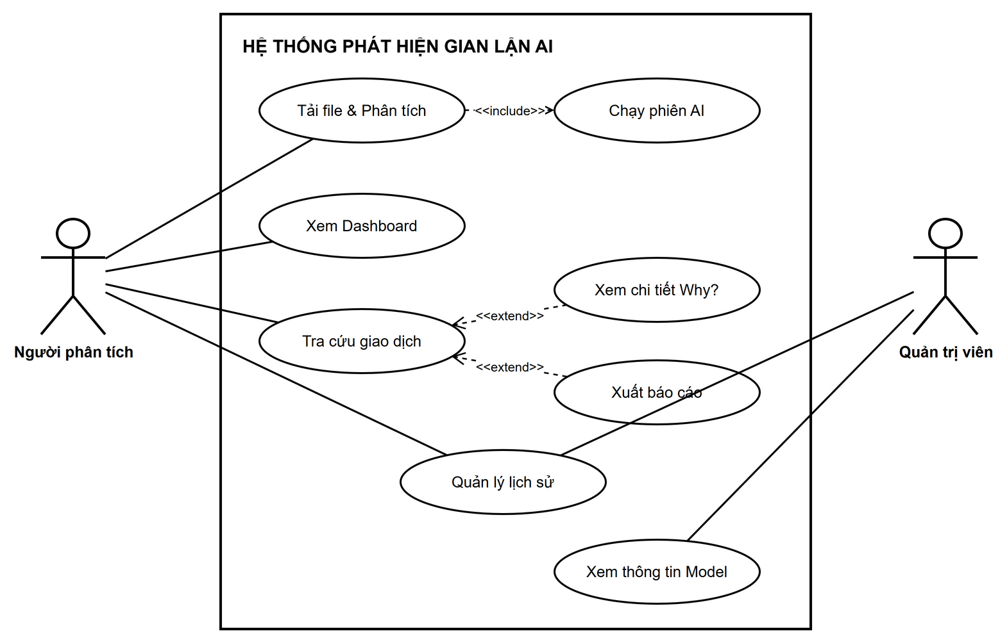

*Hình 3.2. Biểu đồ Use Case tổng quát* — [draw.io](diagrams/Hình 3.2. Biểu đồ Use Case tổng quát.drawio)

#### c. Biểu đồ Use Case phân rã

**Phân rã theo tác nhân Người phân tích — nhóm quản lý phiên phân tích:**

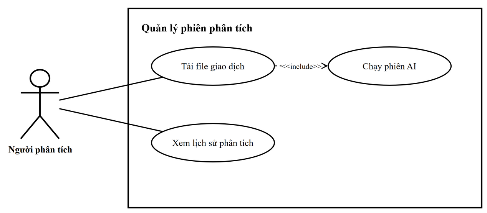

*Hình 3.3. Biểu đồ Use Case phân rã — Người phân tích (quản lý phiên phân tích)* — [draw.io](diagrams/Hình 3.3. Biểu đồ Use Case phân rã — Người phân tích - quản lý phiên phân tích.drawio)

**Phân rã theo tác nhân Người phân tích — nhóm tra cứu kết quả:**

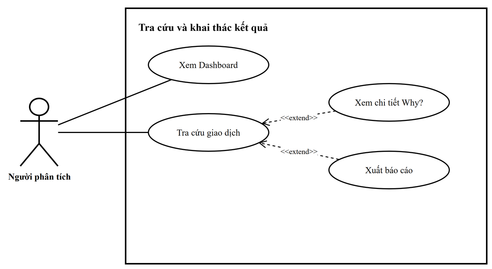

*Hình 3.4. Biểu đồ Use Case phân rã — Người phân tích (tra cứu kết quả)* — [draw.io](diagrams/Hình 3.4. Biểu đồ Use Case phân rã — Người phân tích - tra cứu kết quả.drawio)

**Phân rã theo tác nhân Quản trị viên:**

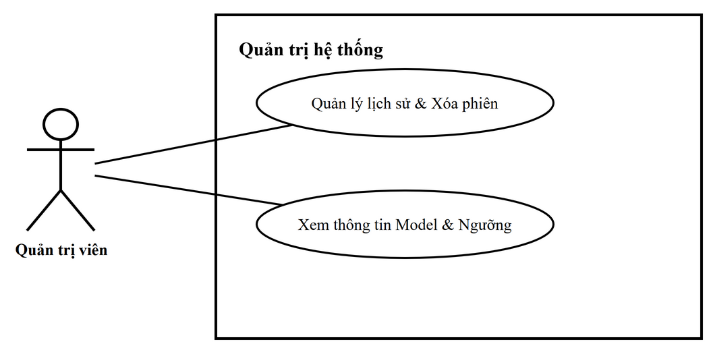

*Hình 3.5. Biểu đồ Use Case phân rã — Quản trị viên* — [draw.io](diagrams/Hình 3.5. Biểu đồ Use Case phân rã — Quản trị viên.drawio)

#### d. Bảng đặc tả Use Case

**Bảng 3.1. Đặc tả Use Case UC01 — Upload file giao dịch**

| Mục | Nội dung |
|---|---|
| Mã use case | UC01 |
| Tên use case | Upload file giao dịch |
| Tác nhân | Người phân tích |
| Mô tả | Người dùng tải file CSV/XLSX chứa danh sách giao dịch lên hệ thống để tạo một phiên phân tích mới |
| Sự kiện kích hoạt | Nhấn nút "Phân tích" trên trang Upload |
| Tiền điều kiện | Model artifact đã được nạp thành công khi khởi động server |
| Hậu điều kiện | Phiên phân tích ở trạng thái `queued` và tự động chạy nền; FE chuyển sang trang Dashboard và bắt đầu polling |

Luồng sự kiện chính:

| STT | Thực hiện bởi | Hành động |
|---|---|---|
| 1 | Người phân tích | Truy cập trang Upload, chọn file CSV/XLSX (≤ 20MB, ≤ 100.000 dòng) |
| 2 | Hệ thống | Hiển thị form chọn `threshold_profile` (`high_recall` / `balanced` / `strict` / `cost_optimal`, mặc định `cost_optimal`) |
| 3 | Người phân tích | Chọn profile và nhấn nút Upload |
| 4 | Hệ thống | Kiểm tra phần mở rộng file là `.csv` hoặc `.xlsx` |
| 5 | Hệ thống | Kiểm tra kích thước ≤ 20MB và số dòng ≤ 100.000 |
| 6 | Hệ thống | Đọc file bằng pandas; nếu là dữ liệu Kaggle (có `trans_num`, `cc_num`…) tự động ánh xạ về schema chuẩn |
| 7 | Hệ thống | Kiểm tra cột bắt buộc (`amount` > 0, `transaction_time`) và validate từng dòng theo schema `Transaction` |
| 8 | Hệ thống | Tạo bản ghi Analysis với `status = queued`, đẩy job chấm điểm chạy nền, trả về `202 Accepted` kèm object Analysis |

Luồng sự kiện thay thế:

| STT | Thực hiện bởi | Hành động |
|---|---|---|
| 4a | Hệ thống | File không phải CSV/XLSX → lỗi `UNSUPPORTED_FORMAT` (400) |
| 5a | Hệ thống | File > 20MB hoặc > 100.000 dòng → lỗi `FILE_TOO_LARGE` / `ROW_LIMIT_EXCEEDED` (413) |
| 6a | Hệ thống | File rỗng, parse lỗi, thiếu cột bắt buộc hoặc dòng dữ liệu sai → lỗi `INVALID_FILE` (422) |
| 8a | Hệ thống | Model chưa nạp → lỗi `MODEL_NOT_LOADED` (503), không tạo phiên |

**Bảng 3.2. Đặc tả Use Case UC02 — Chạy phiên phân tích (job nền)**

| Mục | Nội dung |
|---|---|
| Mã use case | UC02 |
| Tên use case | Chạy phiên phân tích |
| Tác nhân | Hệ thống AI (thực thi); Người phân tích (khởi tạo gián tiếp qua UC01) |
| Mô tả | Job nền chấm điểm lần lượt toàn bộ giao dịch của phiên: tính xác suất gian lận, phát hiện bất thường, tính điểm rủi ro và quyết định xử lý |
| Sự kiện kích hoạt | Phiên phân tích được tạo thành công (UC01 — bước 8) |
| Tiền điều kiện | Tồn tại bản ghi Analysis `queued`; model artifact đã nạp |
| Hậu điều kiện | Toàn bộ giao dịch đã chấm điểm được lưu vào bảng `transactions`; phiên chuyển `completed` kèm summary; nếu lỗi thì `failed` kèm message |

Luồng sự kiện chính:

| STT | Thực hiện bởi | Hành động |
|---|---|---|
| 1 | Hệ thống AI | Cập nhật `status = processing` |
| 2 | Hệ thống AI | Lấy model từ bộ chia sẻ với legacy API (nạp một lần duy nhất khi server khởi động) |
| 3 | Hệ thống AI | Sắp xếp giao dịch theo `transaction_time` để các đặc trưng velocity/history đúng thứ tự thời gian |
| 4 | Hệ thống AI | Khởi tạo `FeatureState` riêng cho phiên (trạng thái trực tuyến: lịch sử thẻ, merchant, thành phố…) |
| 5 | Hệ thống AI | Với từng chunk 5.000 dòng: sinh 34 đặc trưng → Random Forest dự đoán `fraud_probability` → hiệu chỉnh Platt → Isolation Forest tính `anomaly`, `anomaly_score` |
| 6 | Hệ thống AI | Gọi Risk Scorer: `risk_score = (0.75×P + 0.25×max(anomaly_score, anomaly))×100`, suy ra `risk_level`, `decision`, `reasons` theo profile ngưỡng |
| 7 | Hệ thống AI | Ghi chunk vào bảng `transactions`, cập nhật `processed_rows` để FE theo dõi tiến độ |
| 8 | Hệ thống AI | Hết dữ liệu: tổng hợp summary (KPI, phân bố rủi ro/quyết định, trends theo ngày, breakdown theo thiết bị/quốc gia), lưu summary, đặt `status = completed` |

Luồng sự kiện thay thế:

| STT | Thực hiện bởi | Hành động |
|---|---|---|
| 2a | Hệ thống AI | Model chưa nạp → `status = failed` kèm thông điệp lỗi |
| 5a | Hệ thống AI | Ngoại lệ bất kỳ trong lúc chấm → `status = failed`, ghi `error` (tối đa 2000 ký tự) |
| 8a | Hệ thống | Server restart khi job đang chạy → lúc khởi động tiếp, job cũ bị đánh dấu `failed` (`interrupted by server restart`) vì không thể phục hồi trạng thái giữa chừng |

**Bảng 3.3. Đặc tả Use Case UC03 — Theo dõi tiến độ phân tích**

| Mục | Nội dung |
|---|---|
| Mã use case | UC03 |
| Tên use case | Theo dõi tiến độ phân tích |
| Tác nhân | Người phân tích |
| Mô tả | FE định kỳ hỏi trạng thái phiên phân tích để hiển thị tiến độ và biết khi nào nhận được kết quả |
| Sự kiện kích hoạt | Nhận `202` kèm `id` phiên từ UC01 |
| Tiền điều kiện | Đã có id phiên phân tích |
| Hậu điều kiện | FE biết chính xác thời điểm phiên `completed`/`failed` để dừng polling |

Luồng sự kiện chính:

| STT | Thực hiện bởi | Hành động |
|---|---|---|
| 1 | FE | Gọi `GET /api/v1/analyses/{id}` mỗi 1–2 giây (polling) |
| 2 | Hệ thống | Đọc bản ghi Analysis và trả về `{status, processed_rows, row_count, summary}` |
| 3 | FE | Hiển thị tiến độ `processed_rows/row_count`; tiếp tục polling nếu còn `queued/processing` |
| 4 | FE | Dừng polling khi `status` là `completed` (render dashboard) hoặc `failed` (hiển thị lỗi) |

Luồng sự kiện thay thế:

| STT | Thực hiện bởi | Hành động |
|---|---|---|
| 2a | Hệ thống | id không tồn tại → lỗi `ANALYSIS_NOT_FOUND` (404), FE hiển thị trang lỗi |

**Bảng 3.4. Đặc tả Use Case UC04 — Xem lịch sử phân tích**

| Mục | Nội dung |
|---|---|
| Mã use case | UC04 |
| Tên use case | Xem lịch sử phân tích |
| Tác nhân | Người phân tích, Quản trị viên |
| Mô tả | Xem danh sách các phiên phân tích đã tạo, sắp xếp theo thời gian tạo giảm dần, có phân trang |
| Sự kiện kích hoạt | Chọn mục "Lịch sử" trên thanh điều hướng |
| Tiền điều kiện | Không bắt buộc |
| Hậu điều kiện | Danh sách phiên hiển thị kèm trạng thái, người dùng có thể mở một phiên để xem chi tiết |

Luồng sự kiện chính:

| STT | Thực hiện bởi | Hành động |
|---|---|---|
| 1 | Người phân tích | Truy cập trang Lịch sử (`/analyses`) |
| 2 | FE | Gọi `GET /api/v1/analyses?page=&page_size=` |
| 3 | Hệ thống | Trả `{items, total, page, page_size}` — mỗi item gồm id, filename, status, row_count, threshold_profile, thời gian tạo/hoàn tất |
| 4 | FE | Render danh sách với badge trạng thái và phân trang |

Luồng sự kiện thay thế:

| STT | Thực hiện bởi | Hành động |
|---|---|---|
| 4a | FE | Danh sách rỗng → hiển thị empty state kèm nút điều hướng về trang Upload |

**Bảng 3.5. Đặc tả Use Case UC05 — Xóa phiên phân tích**

| Mục | Nội dung |
|---|---|
| Mã use case | UC05 |
| Tên use case | Xóa phiên phân tích |
| Tác nhân | Quản trị viên |
| Mô tả | Xóa vĩnh viễn một phiên phân tích cùng toàn bộ giao dịch con của nó để giải phóng dữ liệu |
| Sự kiện kích hoạt | Nhấn nút "Xóa" trên một dòng trong trang Lịch sử |
| Tiền điều kiện | Phiên phân tích tồn tại |
| Hậu điều kiện | Bản ghi Analysis và toàn bộ TransactionRow tương ứng bị xóa khỏi CSDL |

Luồng sự kiện chính:

| STT | Thực hiện bởi | Hành động |
|---|---|---|
| 1 | Quản trị viên | Nhấn nút Xóa trên phiên cần xóa |
| 2 | FE | Hiển thị hộp thoại xác nhận |
| 3 | Quản trị viên | Xác nhận xóa |
| 4 | FE | Gọi `DELETE /api/v1/analyses/{id}` |
| 5 | Hệ thống | Xóa transactions con rồi xóa Analysis, trả `204 No Content` |
| 6 | FE | Cập nhật lại danh sách lịch sử |

Luồng sự kiện thay thế:

| STT | Thực hiện bởi | Hành động |
|---|---|---|
| 5a | Hệ thống | id không tồn tại → lỗi `ANALYSIS_NOT_FOUND` (404) |
| 5b | Quản trị viên | Từ chối xác nhận → không có request nào được gửi |

**Bảng 3.6. Đặc tả Use Case UC06 — Xem dashboard thống kê**

| Mục | Nội dung |
|---|---|
| Mã use case | UC06 |
| Tên use case | Xem dashboard thống kê |
| Tác nhân | Người phân tích |
| Mô tả | Xem tổng quan kết quả phiên phân tích: các chỉ số KPI, phân bố mức rủi ro, phân bố quyết định, xu hướng theo ngày và cơ cấu theo thiết bị/quốc gia |
| Sự kiện kích hoạt | Upload thành công (tự chuyển hướng) hoặc mở một phiên từ trang Lịch sử |
| Tiền điều kiện | Đã có id phiên phân tích |
| Hậu điều kiện | Dashboard hiển thị đầy đủ khi `status = completed` |

Luồng sự kiện chính:

| STT | Thực hiện bởi | Hành động |
|---|---|---|
| 1 | Người phân tích | Mở trang Dashboard (`/analyses/:id`) |
| 2 | FE | Gọi `GET /api/v1/analyses/{id}` (chính là endpoint polling của UC03) |
| 3 | Hệ thống | Khi `completed`, trả summary: tổng giao dịch, số giao dịch bị gắn cờ, tỷ lệ gắn cờ, tỷ lệ gian lận có nhãn, trung bình xác suất/điểm rủi ro, tổng số tiền, phân bố risk/decision, trends, breakdown |
| 4 | FE | Render thẻ KPI + biểu đồ (Recharts): pie phân bố mức rủi ro, bar phân bố quyết định, line xu hướng theo ngày, bảng breakdown |

Luồng sự kiện thay thế:

| STT | Thực hiện bởi | Hành động |
|---|---|---|
| 3a | Hệ thống | `queued/processing` → `summary = null`, FE hiển thị banner tiến độ và tiếp tục polling |
| 3b | Hệ thống | `failed` → FE hiển thị thông báo lỗi kèm message |
| 3c | Hệ thống | File upload không có cột `is_fraud` → `labeled_fraud_rate = null`, FE hiển thị "—" |

**Bảng 3.7. Đặc tả Use Case UC07 — Tra cứu danh sách giao dịch**

| Mục | Nội dung |
|---|---|
| Mã use case | UC07 |
| Tên use case | Tra cứu danh sách giao dịch |
| Tác nhân | Người phân tích |
| Mô tả | Xem bảng giao dịch đã chấm điểm của một phiên với khả năng lọc theo mức rủi ro/quyết định, tìm kiếm theo từ khóa, sắp xếp và phân trang |
| Sự kiện kích hoạt | Chọn "Giao dịch" từ Dashboard hoặc thanh điều hướng |
| Tiền điều kiện | Phiên phân tích đã `completed` |
| Hậu điều kiện | Bảng giao dịch hiển thị đúng bộ lọc; người dùng có thể mở chi tiết một giao dịch |

Luồng sự kiện chính:

| STT | Thực hiện bởi | Hành động |
|---|---|---|
| 1 | Người phân tích | Mở trang Giao dịch (`/analyses/:id/transactions`) |
| 2 | FE | Gọi `GET /api/v1/analyses/{id}/transactions` với tham số mặc định (`sort=risk_score`, `order=desc`, `page=1`, `page_size=20`) |
| 3 | Hệ thống | Kiểm tra phiên đã completed, truy vấn SQL có điều kiện, trả `{items, total, page, page_size}` |
| 4 | FE | Render bảng: thông tin giao dịch + `fraud_probability`, `anomaly`, `risk_score`, `risk_level`, `decision` |
| 5 | Người phân tích | Thay đổi bộ lọc / từ khóa / sắp xếp / trang |
| 6 | FE | Gửi lại truy vấn với tham số mới và cập nhật bảng |

Luồng sự kiện thay thế:

| STT | Thực hiện bởi | Hành động |
|---|---|---|
| 3a | Hệ thống | Phiên chưa completed → lỗi `ANALYSIS_NOT_COMPLETED` (409) |
| 3b | Hệ thống | Phiên không tồn tại → lỗi `ANALYSIS_NOT_FOUND` (404) |

**Bảng 3.8. Đặc tả Use Case UC08 — Xem chi tiết giao dịch và giải thích "Why?"**

| Mục | Nội dung |
|---|---|
| Mã use case | UC08 |
| Tên use case | Xem chi tiết giao dịch và giải thích "Why?" |
| Tác nhân | Người phân tích |
| Mô tả | Xem toàn bộ thông tin của một giao dịch: điểm số, mức rủi ro, quyết định, các lý do bị gắn cờ (reasons) và dữ liệu gốc của dòng upload |
| Sự kiện kích hoạt | Nhấn vào một dòng giao dịch trong bảng kết quả |
| Tiền điều kiện | Phiên phân tích đã `completed`; `transaction_id` thuộc phiên đó |
| Hậu điều kiện | Màn hình chi tiết hiển thị điểm số và lời giải thích tiếng Việt cho từng mã reason |

Luồng sự kiện chính:

| STT | Thực hiện bởi | Hành động |
|---|---|---|
| 1 | Người phân tích | Nhấn vào giao dịch cần xem |
| 2 | FE | Gọi `GET /api/v1/analyses/{id}/transactions/{transaction_id}` |
| 3 | Hệ thống | Trả object giao dịch kèm `raw` (dữ liệu gốc đã sanitize NaN→null), `analysis_id`, `threshold_profile` |
| 4 | FE | Map mã `reasons` sang câu tiếng Việt: `high_model_probability` → "Xác suất gian lận cao (≥ ngưỡng của profile)"; `anomalous_transaction_pattern` → "Mẫu giao dịch bất thường (Isolation Forest)"; `high_transaction_amount` → "Số tiền lớn bất thường (≥ 3.000)" |
| 5 | FE | Render: vòng tròn Risk score /100, badge mức rủi ro, badge quyết định, danh mục "Why?", bảng dữ liệu gốc |

Luồng sự kiện thay thế:

| STT | Thực hiện bởi | Hành động |
|---|---|---|
| 3a | Hệ thống | `transaction_id` không thuộc phiên → lỗi `TRANSACTION_NOT_FOUND` (404) |
| 3b | Hệ thống | Phiên chưa completed → lỗi `ANALYSIS_NOT_COMPLETED` (409) |

**Bảng 3.9. Đặc tả Use Case UC09 — Xuất kết quả phân tích**

| Mục | Nội dung |
|---|---|
| Mã use case | UC09 |
| Tên use case | Xuất kết quả phân tích |
| Tác nhân | Người phân tích |
| Mô tả | Tải toàn bộ kết quả chấm điểm của một phiên về máy dưới dạng CSV hoặc XLSX |
| Sự kiện kích hoạt | Nhấn nút "Export" trên Dashboard |
| Tiền điều kiện | Phiên phân tích đã `completed` |
| Hậu điều kiện | File kết quả được trình duyệt tải về với tên `<tên_file>_results.csv|.xlsx` |

Luồng sự kiện chính:

| STT | Thực hiện bởi | Hành động |
|---|---|---|
| 1 | Người phân tích | Chọn định dạng và nhấn Export |
| 2 | FE | Gọi `GET /api/v1/analyses/{id}/export?format=csv|xlsx` |
| 3 | Hệ thống | Với CSV: stream từng dòng (không nạp toàn bộ vào RAM); với XLSX: dựng DataFrame rồi ghi bằng openpyxl |
| 4 | Hệ thống | Trả file stream kèm header `Content-Disposition` |
| 5 | Trình duyệt | Tải file về máy người dùng |

Luồng sự kiện thay thế:

| STT | Thực hiện bởi | Hành động |
|---|---|---|
| 3a | Hệ thống | Phiên chưa completed → lỗi `ANALYSIS_NOT_COMPLETED` (409) |
| 3b | Hệ thống | `format` khác `csv|xlsx` → lỗi `UNSUPPORTED_FORMAT` (400) |

**Bảng 3.10. Đặc tả Use Case UC10 — Xem thông tin model**

| Mục | Nội dung |
|---|---|
| Mã use case | UC10 |
| Tên use case | Xem thông tin model |
| Tác nhân | Quản trị viên |
| Mô tả | Theo dõi trạng thái và chất lượng model đang phục vụ: phiên bản, số lượng đặc trưng, bộ ngưỡng theo từng threshold_profile và các chỉ số đánh giá |
| Sự kiện kích hoạt | Mở khu vực "Thông tin model" trên giao diện |
| Tiền điều kiện | Không bắt buộc (endpoint luôn trả 200, kèm cờ `model_loaded`) |
| Hậu điều kiện | Người quản trị nắm được model hiện hành để quyết định threshold_profile phù hợp |

Luồng sự kiện chính:

| STT | Thực hiện bởi | Hành động |
|---|---|---|
| 1 | Quản trị viên | Mở khu vực thông tin model |
| 2 | FE | Gọi `GET /api/v1/model/meta` |
| 3 | Hệ thống | Đọc `thresholds.json`, `metrics.json`, `evaluation_metrics.json`, `feature_schema.json` từ thư mục artifacts |
| 4 | Hệ thống | Trả `{model_loaded, model_version, schema_version, feature_count, thresholds, metrics}` |
| 5 | FE | Hiển thị thông tin; nếu `model_loaded = false` hiển thị cảnh báo model chưa sẵn sàng |

Luồng sự kiện thay thế:

| STT | Thực hiện bởi | Hành động |
|---|---|---|
| 3a | Hệ thống | Thiếu file artifact → trả về giá trị rỗng/`untrained` thay vì lỗi, FE hiển thị cảnh báo |

**Bảng 3.11. Dữ liệu chức năng "Upload file giao dịch"**

| STT | Trường dữ liệu | Mô tả | Bắt buộc | Điều kiện hợp lệ | Ví dụ |
|---|---|---|---|---|---|
| 1 | `file` | File CSV/XLSX chứa giao dịch | Có | ≤ 20MB, ≤ 100.000 dòng, có đủ cột bắt buộc | `transactions.csv` |
| 2 | `threshold_profile` | Hồ sơ ngưỡng quyết định | Không | `high_recall` \| `balanced` \| `strict` \| `cost_optimal` | `cost_optimal` |

**Bảng 3.12. Dữ liệu đầu vào của file giao dịch**

| STT | Trường dữ liệu | Mô tả | Bắt buộc | Điều kiện hợp lệ | Ví dụ |
|---|---|---|---|---|---|
| 1 | `amount` | Số tiền giao dịch | Có | Số thực > 0 | `1200.50` |
| 2 | `transaction_time` | Thời điểm giao dịch | Có | datetime parse được (ISO hoặc pandas) | `2024-03-15T10:30:00` |
| 3 | `user_id` | Mã người dùng | Không | Số nguyên ≥ 1 (mặc định 1) | `100` |
| 4 | `age` | Tuổi | Không | 18–120 (mặc định 35) | `34` |
| 5 | `payment_method` | Phương thức thanh toán | Không | Chuỗi không rỗng | `credit` |
| 6 | `device` | Thiết bị | Không | Chuỗi không rỗng | `mobile` |
| 7 | `country` | Quốc gia | Không | Chuỗi không rỗng | `US` |
| 8 | `transaction_id` | Mã giao dịch | Không | Chuỗi (tự sinh nếu thiếu) | `txn_001` |
| 9 | `merchant_id`, `merchant_category`, tọa độ, `city`, `state`… | Dữ liệu bổ sung cho đặc trưng | Không | Chuỗi/số hợp lệ | `fraud_K` |
| 10 | `is_fraud` | Nhãn gian lận (chỉ dùng thống kê, không đưa vào feature) | Không | 0/1 | `1` |

> Ghi chú: dữ liệu Kaggle dùng tên cột riêng (`trans_num`, `cc_num`, `amt`, `trans_date_trans_time`…) sẽ được adapter tự ánh xạ về schema chuẩn trên.

**Bảng 3.13. Tham số truy vấn danh sách giao dịch**

| STT | Tham số | Mô tả | Bắt buộc | Điều kiện hợp lệ | Mặc định |
|---|---|---|---|---|---|
| 1 | `risk_level` | Lọc theo mức rủi ro | Không | `low` \| `medium` \| `high` \| `critical` | — |
| 2 | `decision` | Lọc theo quyết định | Không | `allow` \| `manual_review` \| `block` | — |
| 3 | `q` | Từ khóa tìm kiếm | Không | ≤ 128 ký tự; so khớp `transaction_id`, `user_id`, `country`, `device` | — |
| 4 | `sort` | Trường sắp xếp | Không | `amount` \| `risk_score` \| `fraud_probability` \| `transaction_time` | `risk_score` |
| 5 | `order` | Chiều sắp xếp | Không | `asc` \| `desc` | `desc` |
| 6 | `page` | Trang hiện tại | Không | Số nguyên ≥ 1 | `1` |
| 7 | `page_size` | Số dòng mỗi trang | Không | 1–100 | `20` |

### 3.1.2. Mô hình hóa nghiệp vụ bằng biểu đồ hoạt động

Các biểu đồ hoạt động dưới đây mô tả luồng nghiệp vụ cốt lõi theo phong cách phân làn tối giản của draw.io (Người phân tích | Hệ thống), tập trung vào các bước hành động chính, ngắn gọn và rõ ràng.

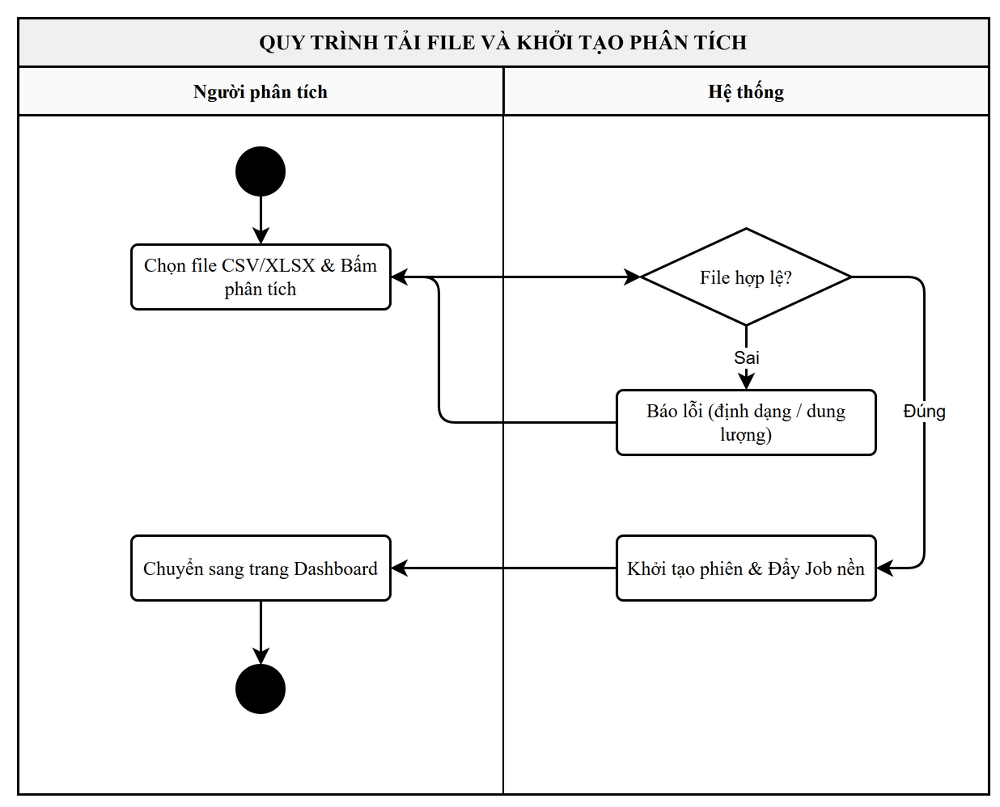

*Hình 3.6. Biểu đồ hoạt động chức năng Upload và khởi tạo phiên phân tích* — [draw.io](diagrams/Hình 3.6. Biểu đồ hoạt động chức năng Upload và khởi tạo phiên phân tích.drawio)

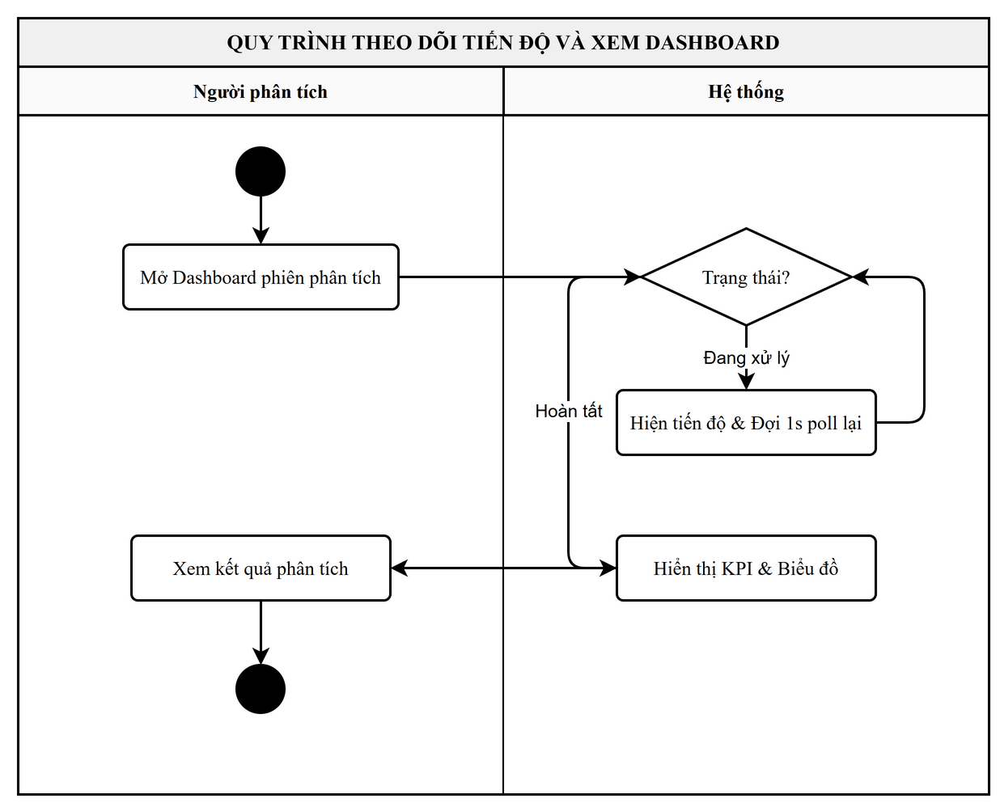

*Hình 3.7. Biểu đồ hoạt động chức năng theo dõi tiến độ và xem dashboard* — [draw.io](diagrams/Hình 3.7. Biểu đồ hoạt động chức năng theo dõi tiến độ và xem dashboard.drawio)

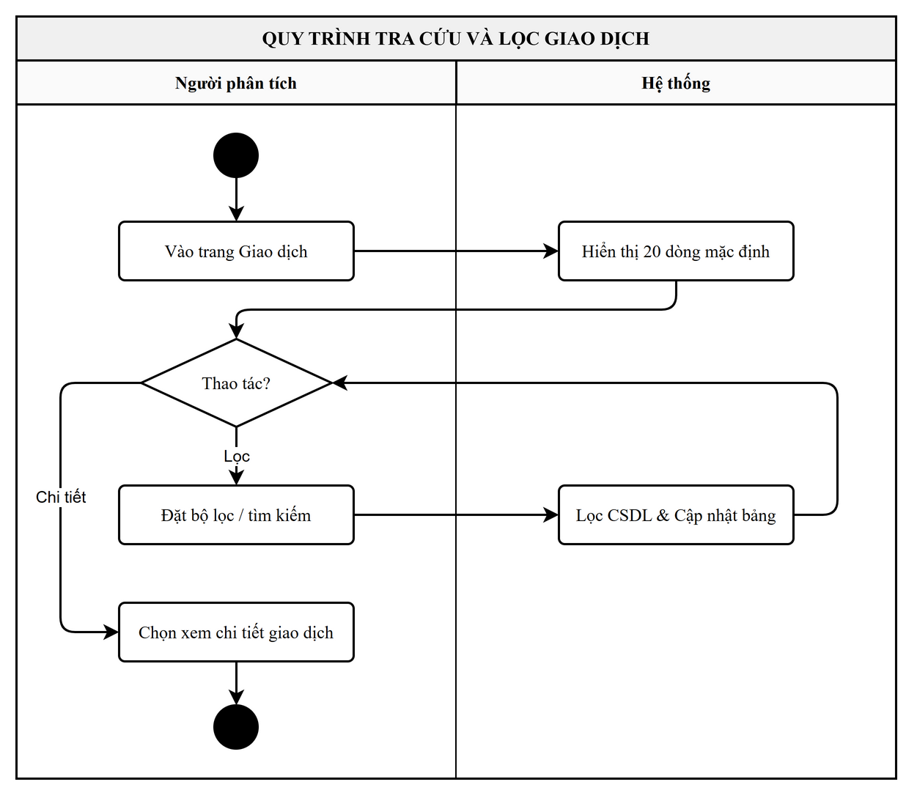

*Hình 3.8. Biểu đồ hoạt động chức năng tra cứu giao dịch (lọc / tìm kiếm / phân trang)* — [draw.io](diagrams/Hình 3.8. Biểu đồ hoạt động chức năng tra cứu giao dịch.drawio)

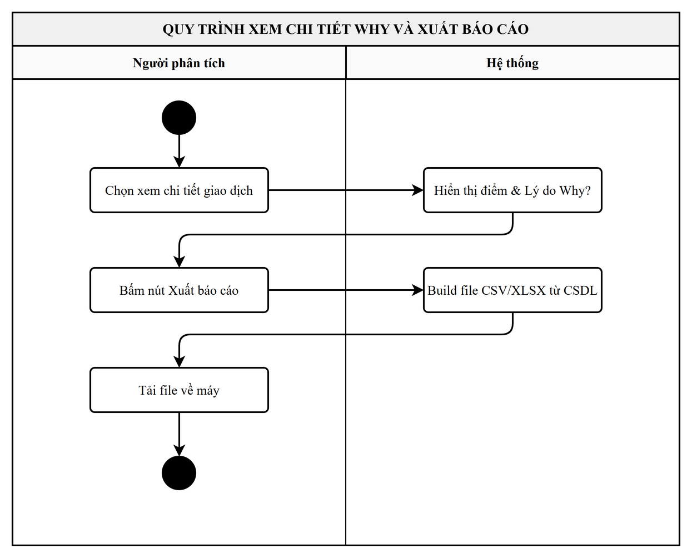

*Hình 3.9. Biểu đồ hoạt động chức năng xem chi tiết "Why?" và xuất kết quả* — [draw.io](diagrams/Hình 3.9. Biểu đồ hoạt động chức năng xem chi tiết Why và xuất kết quả.drawio)

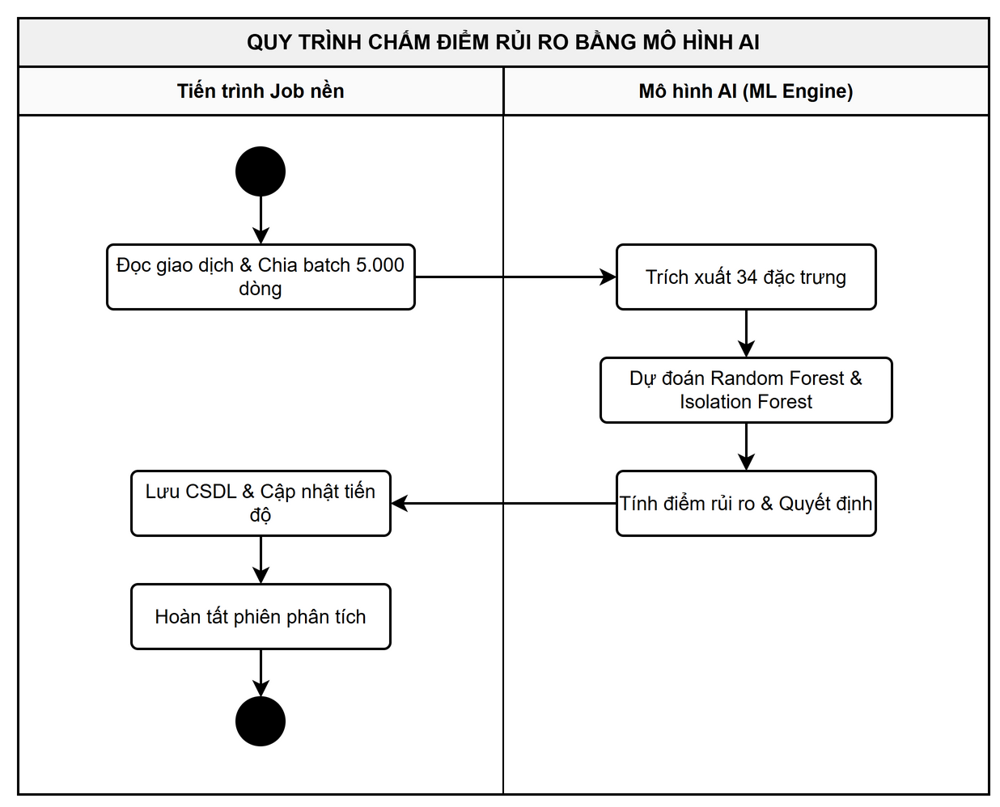

*Hình 3.10. Biểu đồ hoạt động job chấm điểm chạy nền* — [draw.io](diagrams/Hình 3.10. Biểu đồ hoạt động job chấm điểm chạy nền.drawio)

### 3.1.3. Phân tích cấu trúc

Hệ thống gồm ba khối cấu trúc: (1) thực thể dữ liệu (Analysis, TransactionRow), (2) lớp dịch vụ phía backend (API router, storage, model, pipeline, risk scoring) và (3) lớp giao diện phía frontend (5 trang + API client). FE chỉ giao tiếp với BE qua HTTP `/api/v1`, không phụ thuộc trực tiếp vào logic ML. Biểu đồ lớp dưới đây trình bày các lớp chính ở dạng rút gọn.

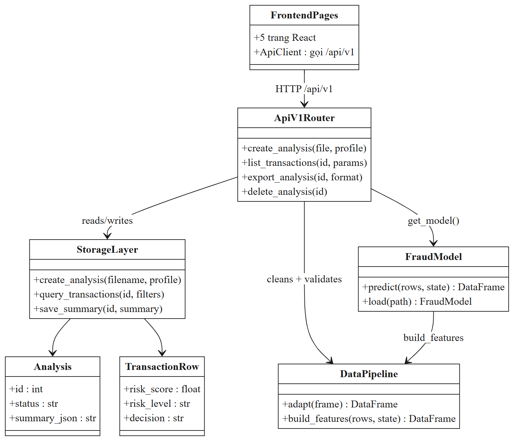

*Hình 3.11. Biểu đồ lớp phân tích cấu trúc hệ thống*

### 3.1.4. Phân tích hành vi

Ba biểu đồ tuần tự mô tả hành vi của các luồng quan trọng nhất: (1) upload và polling phiên phân tích, (2) tra cứu – chi tiết – xuất kết quả và (3) tiến trình chấm điểm nội bộ của job nền.

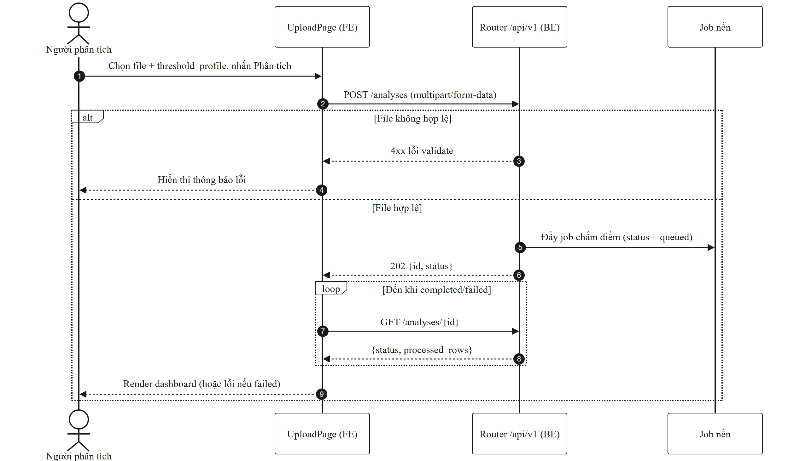

*Hình 3.12. Biểu đồ tuần tự chức năng Upload và theo dõi phiên phân tích*

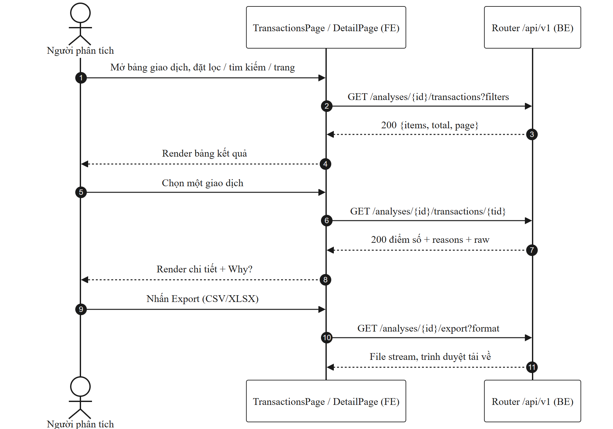

*Hình 3.13. Biểu đồ tuần tự chức năng tra cứu, chi tiết và xuất kết quả*

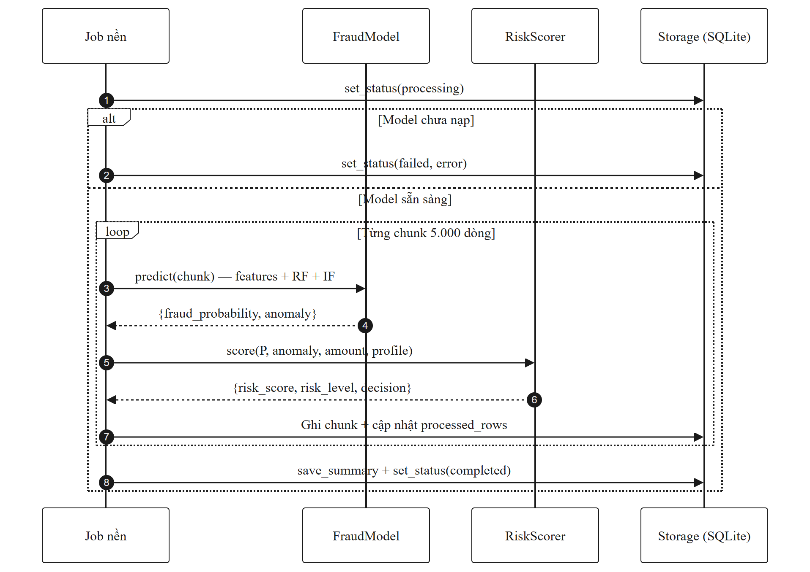

*Hình 3.14. Biểu đồ tuần tự tiến trình chấm điểm nội bộ của job nền*

---

## 3.2. Thiết kế hệ thống

### 3.2.1. Thiết kế giao diện phía người dùng

Giao diện người dùng gồm 5 màn hình, tổ chức theo luồng "upload → theo dõi → khai thác kết quả". Điều hướng dùng React Router; dữ liệu lấy qua API client dùng TanStack Query (tự động polling/refetch).

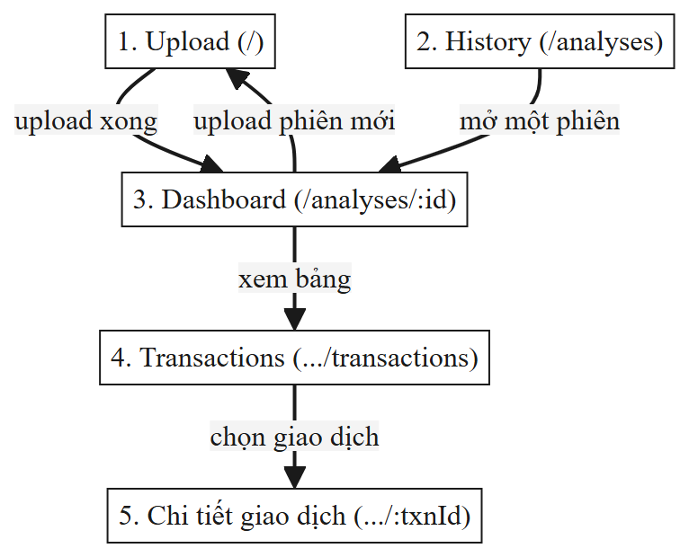

*Hình 3.15. Sơ đồ điều hướng giữa các màn hình*

**Màn hình 1 — Upload (`/`):** form chọn file (kéo-thả) + dropdown `threshold_profile` + nút Phân tích; hiển thị trạng thái model (từ `/model/meta`) và lỗi validate ngay tại form; upload thành công tự chuyển sang Dashboard của phiên vừa tạo.

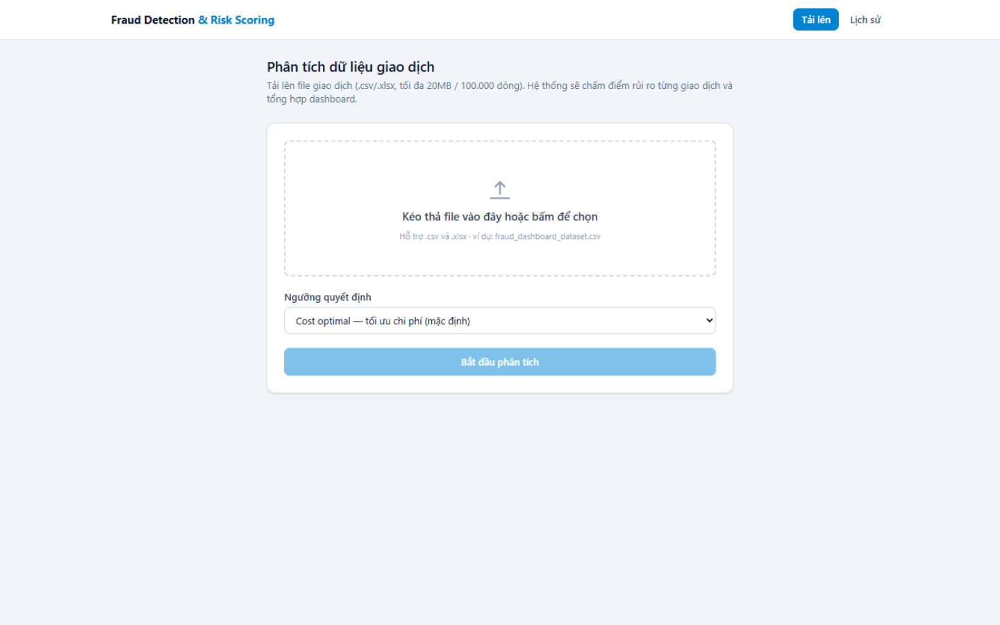

**Màn hình 2 — History (`/analyses`):** danh sách các phiên phân tích (tên file, trạng thái, số dòng, profile, thời gian tạo/hoàn tất), badge màu theo trạng thái, phân trang, nút mở phiên và nút xóa (có xác nhận).

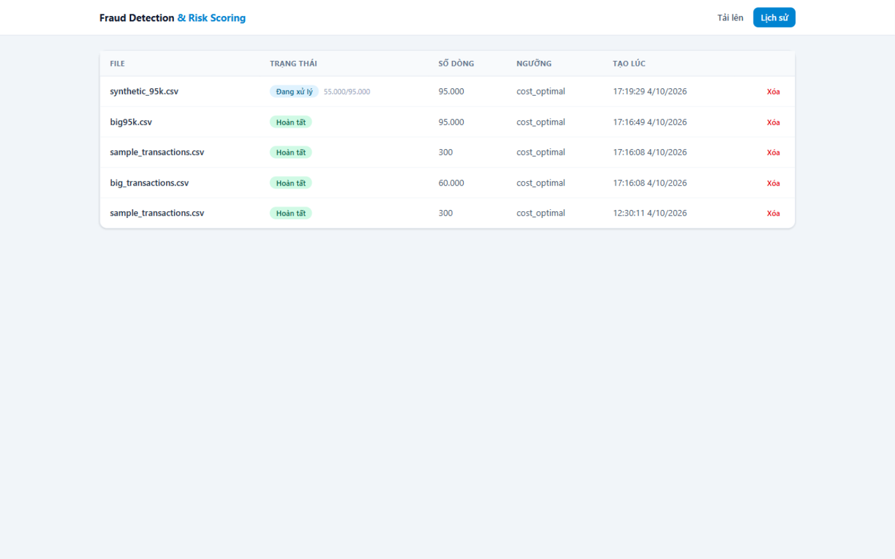

**Màn hình 3 — Dashboard (`/analyses/:id`):** khi chưa xong hiển thị banner tiến độ `processed_rows/row_count` kèm khối skeleton, tự cập nhật qua polling; khi hoàn tất hiển thị thẻ KPI (tổng giao dịch, số gắn cờ, tỷ lệ gắn cờ, tỷ lệ gian lận có nhãn, trung bình xác suất/điểm rủi ro, tổng tiền), biểu đồ tròn phân bố mức rủi ro, biểu đồ cột phân bố quyết định, biểu đồ đường xu hướng theo ngày, bảng top thiết bị/quốc gia; nút Export CSV/XLSX.

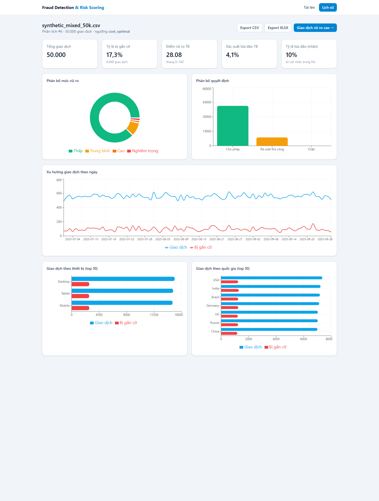

**Màn hình 4 — Transactions (`/analyses/:id/transactions`):** bảng kết quả với bộ lọc `risk_level`, `decision`, ô tìm kiếm `q`, chọn cột sắp xếp và chiều, phân trang; mỗi dòng hiển thị điểm xác suất, badge mức rủi ro và quyết định; nhấn dòng để sang chi tiết.

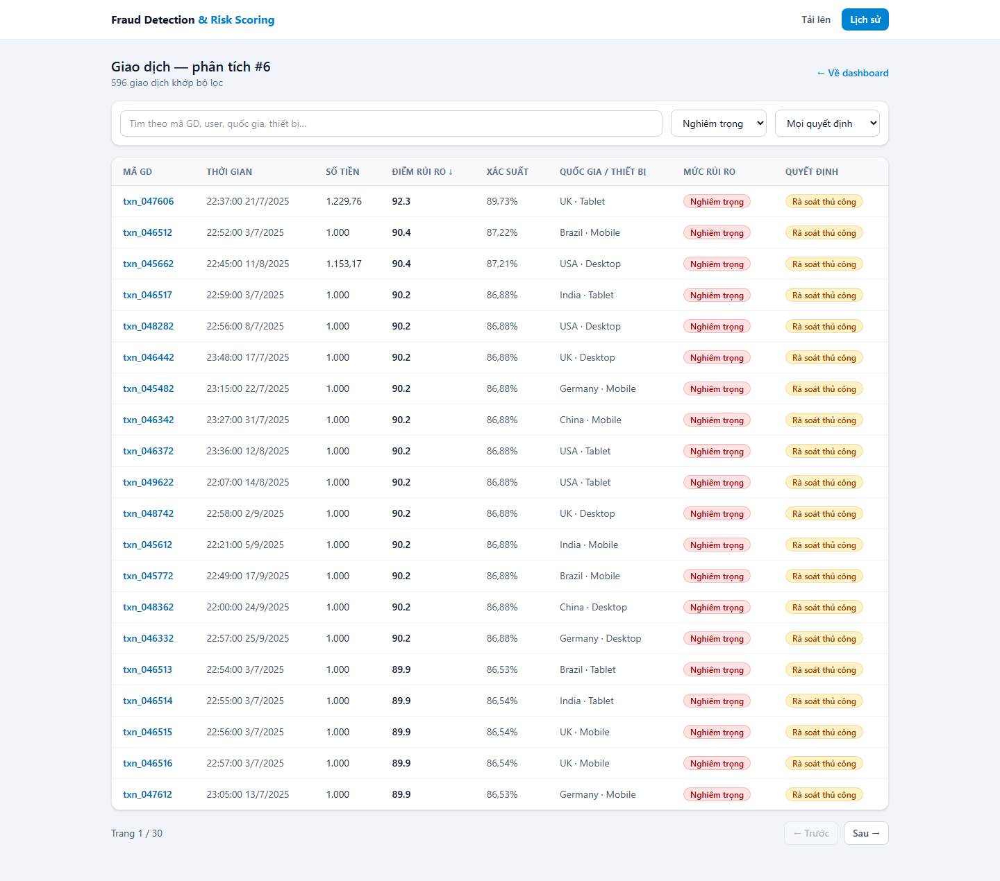

**Màn hình 5 — Transaction Detail (`/analyses/:id/transactions/:txnId`):** vòng điểm Risk score /100, badge mức rủi ro và quyết định, mục **Why?** liệt kê lý do gắn cờ đã map sang tiếng Việt, bảng dữ liệu gốc (`raw`) của dòng upload, nút quay lại bảng.

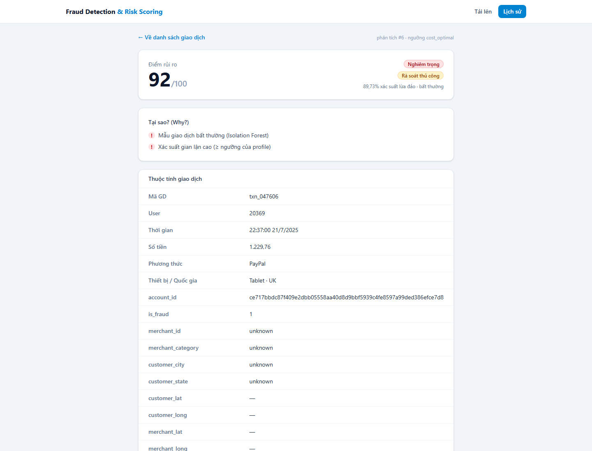

Mỗi màn hình đều thiết kế đủ ba trạng thái: **loading** (skeleton/spinner), **empty** (empty state kèm gợi ý thao tác) và **error** (thông báo lỗi theo `error.code` từ BE, có nút thử lại).

### 3.2.2. Thiết kế giao diện phía quản trị

Hệ thống hiện chưa tách trang admin riêng; các chức năng quản trị được thiết kế dạng "lớp quản trị tích hợp" trong giao diện người dùng, phân biệt theo mục đích sử dụng:

| Chức năng quản trị | Giao diện | API sử dụng | Điểm thiết kế |
|---|---|---|---|
| Quản lý phiên phân tích | Trang History | `GET /analyses`, `DELETE /analyses/{id}` | Nút xóa có hộp thoại xác nhận; hiển thị `threshold_profile` của từng phiên |
| Theo dõi model | Banner cảnh báo trên Dashboard | `GET /model/meta` | Ẩn khi model sẵn sàng; khi `model_loaded = false` hiển thị cảnh báo "model chưa được nạp" để người dùng biết kết quả có thể không chính xác |
| Ra quyết định ngưỡng | Dropdown khi Upload | `threshold_profile` trên `POST /analyses` | Mô tả ngắn từng profile (bắt nhiều bất thường / cân bằng / nghiêm ngặt / tối ưu chi phí) |

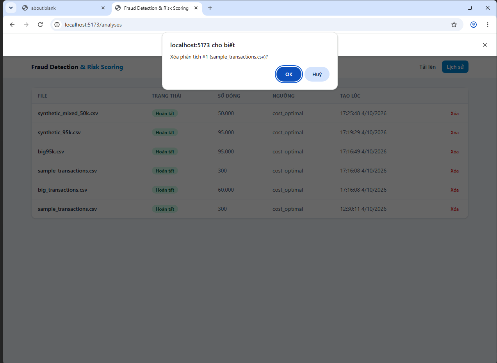

Hướng phát triển tiếp theo của phần quản trị: tách trang `/admin` với đăng nhập, quản lý người dùng và lịch sử thao tác xóa.

---

## 3.3. Xây dựng hệ thống

### 3.3.1. Môi trường phát triển

- **Hệ điều hành:** Windows 11 (lập trình và triển khai thử nghiệm).
- **IDE/Editor:** Visual Studio Code (Python + TypeScript, tích hợp Git).
- **Máy chủ thử nghiệm:** localhost — BE chạy bằng Uvicorn tại cổng 8000, FE dev server Vite tại cổng 5173 (proxy `/api` về BE).
- **Công cụ hỗ trợ:** Git/GitHub (quản lý mã nguồn, Pull Request), Chrome DevTools (debug FE), Postman/khóa `/docs` của FastAPI (thử API), draw.io (vẽ sơ đồ).

Lệnh chạy hệ thống:

```bash
# Backend (cổng 8000, docs tại /docs)
python -m pip install -r requirements.txt
python -m uvicorn backend.app:app --reload

# Frontend (cổng 5173)
cd frontend
npm install
npm run dev
```

### 3.3.2. Xây dựng cơ sở dữ liệu

Cơ sở dữ liệu dùng **SQLite** (file `data/app.db`, có thể đổi qua biến môi trường `FRAUD_DB_PATH`), truy cập bằng SQLAlchemy 2.0. Gồm hai bảng: `analyses` (phiên phân tích) và `transactions` (kết quả chấm điểm từng giao dịch), quan hệ 1–n.

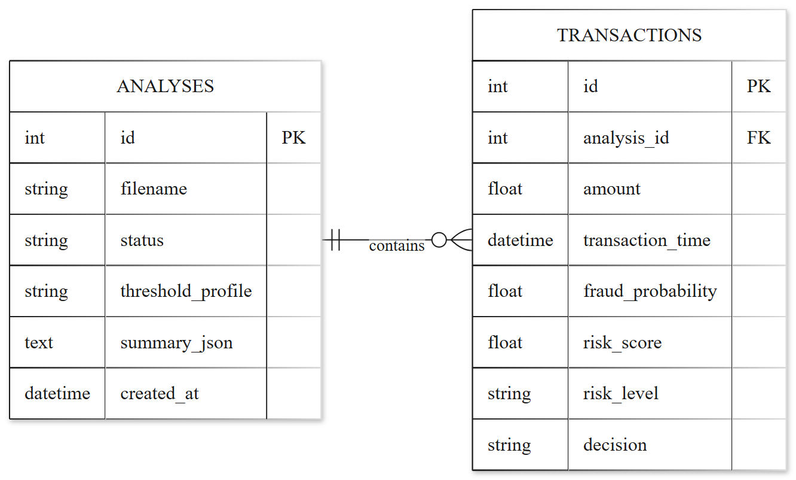

*Hình 3.22. Sơ đồ thực thể — quan hệ cơ sở dữ liệu*

**Bảng 3.14. Bảng dữ liệu `analyses`**

| STT | Tên trường | Kiểu dữ liệu | Mô tả |
|---|---|---|---|
| 1 | id | INTEGER, PK, tự tăng | Mã phiên phân tích |
| 2 | filename | VARCHAR(512) | Tên file được upload |
| 3 | status | VARCHAR(16), index | Trạng thái job: `queued` / `processing` / `completed` / `failed` |
| 4 | row_count | INTEGER, nullable | Tổng số dòng đọc được từ file |
| 5 | processed_rows | INTEGER | Số dòng đã chấm xong (theo dõi tiến độ) |
| 6 | threshold_profile | VARCHAR(32) | Hồ sơ ngưỡng: `high_recall` / `balanced` / `strict` / `cost_optimal` |
| 7 | error | TEXT, nullable | Thông điệp lỗi khi job failed |
| 8 | summary_json | TEXT, nullable | Summary dashboard lưu dạng JSON |
| 9 | created_at | DATETIME | Thời điểm tạo phiên |
| 10 | completed_at | DATETIME, nullable | Thời điểm hoàn tất/failed |

**Bảng 3.15. Bảng dữ liệu `transactions`**

| STT | Tên trường | Kiểu dữ liệu | Mô tả |
|---|---|---|---|
| 1 | id | INTEGER, PK, tự tăng | Mã dòng kết quả |
| 2 | analysis_id | INTEGER, FK → analyses.id | Mã phiên phân tích chứa giao dịch |
| 3 | transaction_id | VARCHAR(128) | Mã giao dịch (nếu file có) |
| 4 | user_id | INTEGER | Mã người dùng |
| 5 | transaction_time | DATETIME | Thời điểm giao dịch |
| 6 | amount | FLOAT | Số tiền giao dịch |
| 7 | payment_method | VARCHAR(64) | Phương thức thanh toán |
| 8 | device | VARCHAR(64) | Thiết bị giao dịch |
| 9 | country | VARCHAR(64) | Quốc gia |
| 10 | fraud_probability | FLOAT | Xác suất gian lận do Random Forest dự đoán (0–1) |
| 11 | anomaly | BOOLEAN | Cờ bất thường của Isolation Forest |
| 12 | risk_score | FLOAT, index | Điểm rủi ro tổng hợp (0–100) |
| 13 | risk_level | VARCHAR(16) | Mức rủi ro: `low` / `medium` / `high` / `critical` |
| 14 | decision | VARCHAR(32) | Quyết định: `allow` / `manual_review` / `block` |
| 15 | reasons_json | TEXT | Danh sách mã lý do gắn cờ dạng JSON |
| 16 | raw_json | TEXT, nullable | Toàn bộ cột gốc của dòng upload (phục vụ màn hình chi tiết) |

Index composite `ix_transactions_analysis_risk` trên `(analysis_id, risk_level)` tối ưu truy vấn lọc theo phiên + mức rủi ro — thao tác truy vấn phổ biến nhất của bảng này.

### 3.3.3. Ngôn ngữ và công nghệ

**Bảng 3.16. Công nghệ và vai trò trong hệ thống**

| Công nghệ | Vai trò |
|---|---|
| Python 3.10+ | Ngôn ngữ backend và huấn luyện model |
| FastAPI + Uvicorn | Web framework ASYNC phục vụ REST API `/api/v1` và legacy endpoints; tự sinh tài liệu OpenAPI tại `/docs` |
| Pydantic | Schema request/response, validate từng dòng giao dịch khi upload |
| SQLAlchemy 2.0 | ORM truy cập SQLite; ORM model khớp hai bảng trên |
| SQLite | CSDL nhúng lưu phiên phân tích và kết quả chấm điểm |
| Pandas / NumPy | Đọc CSV/XLSX, xử lý chunk, tổng hợp summary |
| scikit-learn | RandomForestClassifier (250 cây, `class_weight=balanced_subsample`) cho xác suất gian lận; IsolationForest cho phát hiện bất thường; LogisticRegression cho hiệu chỉnh Platt |
| Joblib | Lưu/nạp model artifact (`fraud_model.joblib`) |
| OpenPyXL | Đọc file `.xlsx` upload và ghi file export `.xlsx` |
| React 18 + TypeScript | Frontend SPA, type-safe API client |
| Vite | Dev server + build frontend, proxy `/api` về BE |
| Tailwind CSS | Hệ thống style giao diện |
| React Router 6 | Điều hướng 5 màn hình |
| TanStack Query 5 | Quản lý trạng thái dữ liệu bất đồng bộ: polling tiến độ, cache, refetch |
| Recharts | Biểu đồ dashboard (pie, bar, line) |
| Vitest + Testing Library | Unit test frontend |
| Pytest | Kiểm thử backend (integration test từng endpoint v1) |
| Power BI | Dashboard phân tích dữ liệu phục vụ giai đoạn khám phá dữ liệu |

### 3.3.4. Cài đặt các chức năng

**a. Nạp model và khởi tạo hệ thống:** khi server khởi động, `load_compatible_model()` nạp `fraud_model.joblib`; artifact chỉ được chấp nhận nếu feature schema khớp với code hiện tại (nếu không, khởi tạo model rỗng và cảnh báo `model_loaded = false`). `lifespan` của FastAPI gọi `init_db()` tạo bảng và `mark_stale_jobs_failed()` đánh dấu các job bị gián đoạn bởi lần restart trước là `failed`.

**b. Chức năng upload và validate file (UC01):** endpoint `POST /api/v1/analyses` kiểm tra theo chuỗi: định dạng → kích thước → parse → số dòng → ánh xạ cột (adapter Kaggle) → validate từng dòng bằng Pydantic. Mọi lỗi trả về envelope thống nhất `{"error": {"code", "message"}}`, FE hiển thị đúng thông điệp theo `code`.

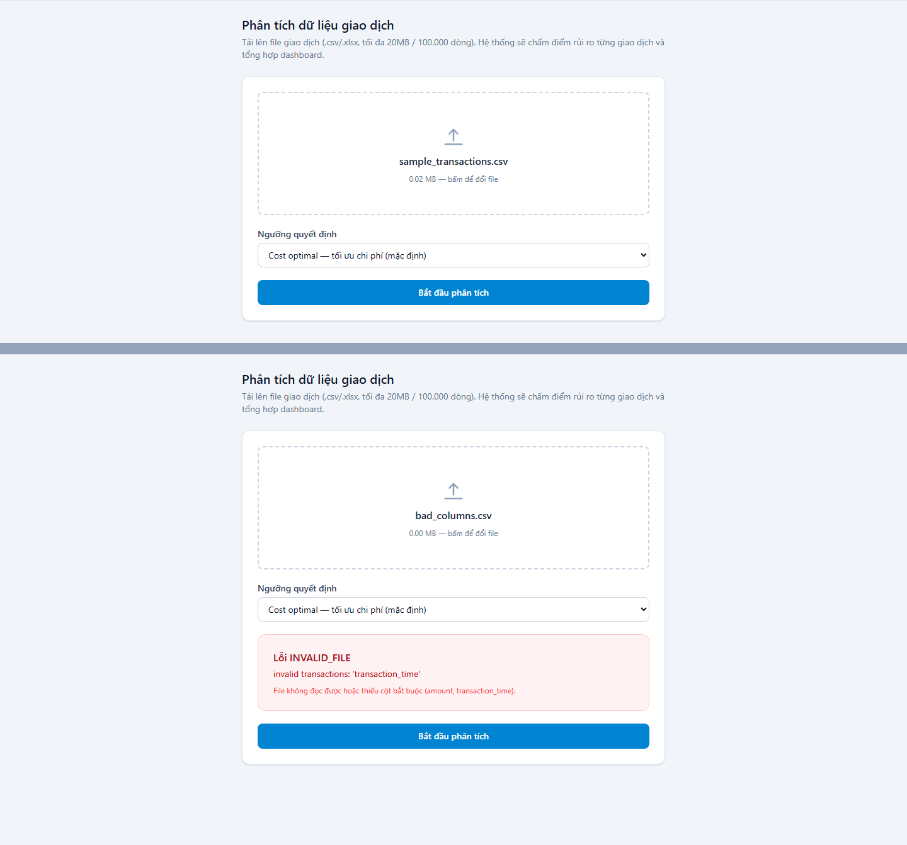

**c. Chức năng phân tích nền (UC02):** job chạy qua `BackgroundTasks` trong threadpool, xử lý theo chunk 5.000 dòng để giới hạn bộ nhớ; mỗi chunk sinh 34 đặc trưng (đếm tần suất thẻ 5 phút/1 giờ/24 giờ/7 ngày, z-score số tiền, khoảng cách nhà–giao dịch, impossible travel, lịch sử merchant…), dự đoán bằng Random Forest + hiệu chỉnh Platt, phát hiện bất thường bằng Isolation Forest rồi tổng hợp điểm rủi ro. `risk_level` ở tầng v1 được chuẩn hóa chữ thường trước khi trả FE.

**d. Chức năng theo dõi tiến độ (UC03):** FE dùng TanStack Query polling `GET /api/v1/analyses/{id}` và hiển thị tỷ lệ `processed_rows/row_count`; polling tự dừng khi nhận `completed`/`failed`.

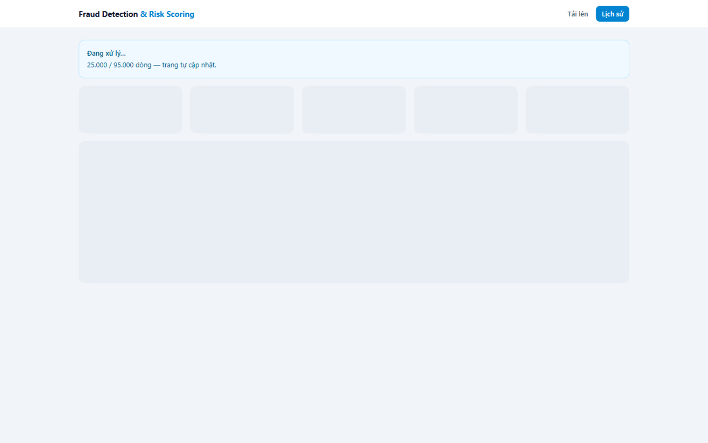

**e. Chức năng dashboard thống kê (UC06):** summary được tính một lần khi job kết thúc và lưu dạng JSON trong `analyses.summary_json` — dashboard chỉ đọc và render, không tính toán lại; các biểu đồ vẽ bằng Recharts.

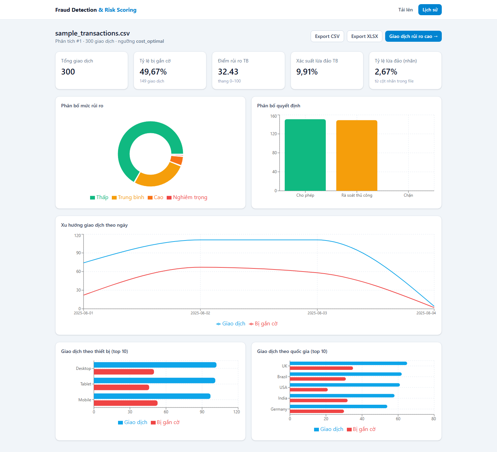

**f. Chức năng tra cứu giao dịch (UC07):** truy vấn được dịch thẳng xuống SQL (filter + sort + phân trang trong câu lệnh, không lọc phía ứng dụng); tìm kiếm `q` dùng LIKE trên 4 trường `transaction_id`, `user_id`, `country`, `device`.

**g. Chức năng chi tiết "Why?" (UC08):** BE trả kèm `raw` (dữ liệu gốc đã sanitize NaN→null) và mã `reasons`; FE map mã sang câu tiếng Việt và hiển thị cùng điểm số — người dùng hiểu được vì sao một giao dịch bị gắn cờ mà không cần hiểu model.

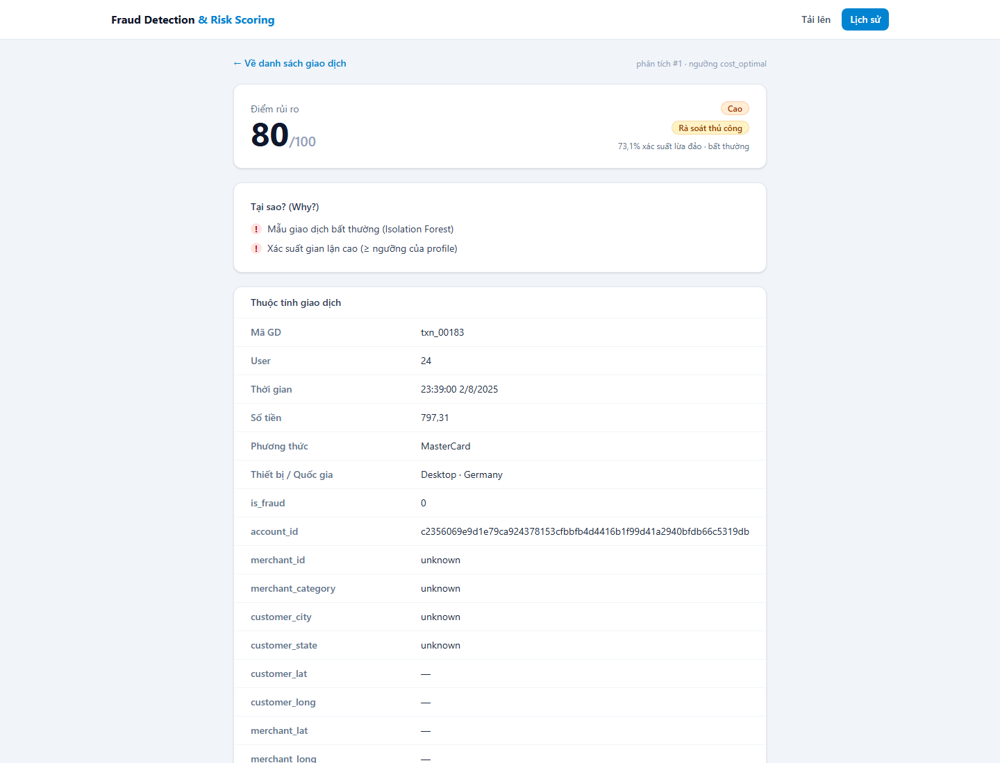

**h. Chức năng xuất kết quả (UC09):** export CSV dùng StreamingResponse ghi từng dòng ra stream (an toàn với 100.000 dòng); export XLSX dựng DataFrame rồi ghi bằng openpyxl; tên file xuất theo file gốc (`<tên_file>_results.csv|.xlsx`).

---

## Danh mục hình — Chương 3

| Hình | Tên | Trạng thái |
|---|---|---|
| Hình 3.1 | Biểu đồ chức năng | [PNG](diagrams/Hình 3.1. Biểu đồ chức năng.png) · Mermaid |
| Hình 3.2 | Biểu đồ Use Case tổng quát | [PNG](diagrams/Hình 3.2. Biểu đồ Use Case tổng quát.png) · Mermaid |
| Hình 3.3 | Use Case phân rã — Người phân tích (quản lý phiên) | [PNG](diagrams/Hình 3.3. Biểu đồ Use Case phân rã — Người phân tích - quản lý phiên phân tích.png) · Mermaid |
| Hình 3.4 | Use Case phân rã — Người phân tích (tra cứu kết quả) | [PNG](diagrams/Hình 3.4. Biểu đồ Use Case phân rã — Người phân tích - tra cứu kết quả.png) · Mermaid |
| Hình 3.5 | Use Case phân rã — Quản trị viên | [PNG](diagrams/Hình 3.5. Biểu đồ Use Case phân rã — Quản trị viên.png) · Mermaid |
| Hình 3.6 | Biểu đồ hoạt động Upload & khởi tạo phiên | [PNG](diagrams/Hình 3.6. Biểu đồ hoạt động chức năng Upload và khởi tạo phiên phân tích.png) · Mermaid |
| Hình 3.7 | Biểu đồ hoạt động Theo dõi tiến độ & Dashboard | [PNG](diagrams/Hình 3.7. Biểu đồ hoạt động chức năng theo dõi tiến độ và xem dashboard.png) · Mermaid |
| Hình 3.8 | Biểu đồ hoạt động Tra cứu giao dịch | [PNG](diagrams/Hình 3.8. Biểu đồ hoạt động chức năng tra cứu giao dịch.png) · Mermaid |
| Hình 3.9 | Biểu đồ hoạt động Chi tiết Why? & Export | [PNG](diagrams/Hình 3.9. Biểu đồ hoạt động chức năng xem chi tiết Why và xuất kết quả.png) · Mermaid |
| Hình 3.10 | Biểu đồ hoạt động Job chấm điểm nền | [PNG](diagrams/Hình 3.10. Biểu đồ hoạt động job chấm điểm chạy nền.png) · Mermaid |
| Hình 3.11 | Biểu đồ lớp phân tích cấu trúc | [PNG](diagrams/Hình 3.11. Biểu đồ lớp phân tích cấu trúc hệ thống.png) · Mermaid |
| Hình 3.12 | Biểu đồ tuần tự Upload & polling | [PNG](diagrams/Hình 3.12. Biểu đồ tuần tự chức năng Upload và theo dõi phiên phân tích.png) · Mermaid |
| Hình 3.13 | Biểu đồ tuần tự Tra cứu & xuất kết quả | [PNG](diagrams/Hình 3.13. Biểu đồ tuần tự chức năng tra cứu, chi tiết và xuất kết quả.png) · Mermaid |
| Hình 3.14 | Biểu đồ tuần tự Job chấm điểm nội bộ | [PNG](diagrams/Hình 3.14. Biểu đồ tuần tự tiến trình chấm điểm nội bộ của job nền.png) · Mermaid |
| Hình 3.15 | Sơ đồ điều hướng giao diện | [PNG](diagrams/Hình 3.15. Sơ đồ điều hướng giữa các màn hình.png) · Mermaid |
| Hình 3.16 | Giao diện trang Upload | [PNG](screenshots/Hình 3.16. Giao diện trang Upload.png) · Ảnh chụp |
| Hình 3.17 | Giao diện trang Lịch sử phân tích | [PNG](screenshots/Hình 3.17. Giao diện trang Lịch sử phân tích.png) · Ảnh chụp |
| Hình 3.18 | Giao diện trang Dashboard | [PNG](screenshots/Hình 3.18. Giao diện trang Dashboard.png) · Ảnh chụp |
| Hình 3.19 | Giao diện trang Danh sách giao dịch | [PNG](screenshots/Hình 3.19. Giao diện trang Danh sách giao dịch.png) · Ảnh chụp |
| Hình 3.20 | Giao diện trang Chi tiết giao dịch (Why?) | [PNG](screenshots/Hình 3.20. Giao diện trang Chi tiết giao dịch Why.png) · Ảnh chụp |
| Hình 3.21 | Hộp thoại xác nhận xóa phiên phân tích | [PNG](screenshots/Hình 3.21. Hộp thoại xác nhận xóa phiên phân tích.png) · Ảnh chụp |
| Hình 3.22 | Sơ đồ ER cơ sở dữ liệu | [PNG](diagrams/Hình 3.22. Sơ đồ thực thể — quan hệ cơ sở dữ liệu.png) · Mermaid |
| Hình 3.23 | Chọn file hợp lệ và thông báo lỗi validate từ backend | [PNG](screenshots/Hình 3.23. Chọn file hợp lệ và thông báo lỗi validate từ backend.png) · Ảnh chụp |
| Hình 3.24 | Banner tiến độ phiên phân tích khi job chạy nền | [PNG](screenshots/Hình 3.24. Banner tiến độ phiên phân tích khi job chạy nền.png) · Ảnh chụp |
| Hình 3.25 | Dashboard tổng quan phiên phân tích | [PNG](screenshots/Hình 3.25. Dashboard tổng quan phiên phân tích.png) · Ảnh chụp |
| Hình 3.26 | Màn hình chi tiết giao dịch với giải thích Why? | [PNG](screenshots/Hình 3.26. Màn hình chi tiết giao dịch với giải thích Why.png) · Ảnh chụp |

## Danh mục bảng — Chương 3

| Bảng | Tên |
|---|---|
| Bảng 3.1–3.10 | Đặc tả Use Case UC01–UC10 |
| Bảng 3.11 | Dữ liệu chức năng "Upload file giao dịch" |
| Bảng 3.12 | Dữ liệu đầu vào của file giao dịch |
| Bảng 3.13 | Tham số truy vấn danh sách giao dịch |
| Bảng 3.14 | Bảng dữ liệu `analyses` |
| Bảng 3.15 | Bảng dữ liệu `transactions` |
| Bảng 3.16 | Công nghệ và vai trò trong hệ thống |
